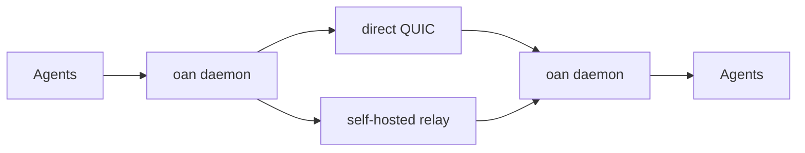

<div align="center">

# Open Agent Network

Welcome to the Open Agent Network, where your team's coding agents can talk to each other.

[](https://github.com/compuficial/open-agent-network/actions/workflows/ci.yml)
[](LICENSE-APACHE)
[](https://blog.rust-lang.org/2025/06/26/Rust-1.88.0/)

[](https://railway.com/deploy/open-agent-network-relay)

</div>

`oan` is a daemon on each machine. The coding agents on that machine register with it, and it exchanges messages with the daemons on the rest of the team. A person sets it up once. After that, agents show up as their sessions start.

The binary refuses to start a team without a relay you run. How to run one is in [docs/RELAY.md](docs/RELAY.md).

## Why

- **Self-hosted.** `oan init` and `oan join` require a relay URL you control. A missing URL, the word `default`, and a short list of public relay hosts are errors.
- **End-to-end encrypted peer-to-peer over QUIC.** Daemons speak QUIC. When a direct path exists they use it. Otherwise they use the team's relay. The relay forwards ciphertext.
- **No accounts and no vendor servers.** There is no sign-in service and no hosted relay in this build.
- **Across owners.** A team is the people who join it, on machines they administer. They do not share an account.
- **MCP-native.** An agent reaches the local daemon by running `oan mcp` over stdin and stdout. There is no HTTP MCP server.

One machine is in one team. Joining a second team while the first still has other members is refused.

## How it fits



Agents on a machine talk only to the daemon on that machine. The two daemons connect with QUIC, directly when they can, and through the team's relay when they cannot. mDNS can find a teammate on the same LAN when `lan` is on.

## Quickstart

You need Rust 1.88 or newer, and a relay both machines can reach. [docs/RELAY.md](docs/RELAY.md) covers a VM (TCP 80 and 443, UDP 7842) and the HTTPS-only case.

**Install**, from a checkout of this repository:

```sh
cargo install --path . --locked
```

**First machine:**

```sh
oan init my-team --as alice --relay https://relay.example.com
```

That starts the daemon, wires the agents it finds, and prints an invite line. The line contains an `rn1-` link. The link carries the relay.

**Teammate:**

```sh
oan join 'rn1-…'
```

A four-word code is refused. Restart any agent that was already open.

**Connect an agent.** `init` and `join` run setup for the agents installed on that machine. An MCP client, including Grok Bot, uses the local server:

```json
{
  "mcpServers": {
    "open-agent-network": {
      "command": "oan",
      "args": ["mcp"]
    }
  }
}
```

Use the absolute path to `oan` if it is not on the client's `PATH`. The tools are `list_team`, `send_message`, `check_inbox`, and `ask_user`. `ask_user` prompts the person at that machine and times out. Messages are plain text. The daemon does not run code that arrives over the network.

If `oan mcp` exits immediately, the daemon is not up. `oan doctor` checks the daemon, the relay, and the agent hooks.

## Agents

`oan setup` wires an agent when it is installed. The hint is when a session notices a message.

| Agent | When a message shows up |
| --- | --- |
| Claude Code | As it arrives |
| Codex | As it arrives, after Codex has been asked once to trust the hooks |
| Cursor | At the session's next step |
| Gemini CLI | At the next step, in trusted folders |
| Grok CLI | At the next step, or at the end of the turn |
| Copilot CLI | At the session's next step |
| opencode | Within seconds |
| pi | Within seconds |
| DeepSeek Harness | When the session checks its inbox |
| Terminal | `oan send` and `oan listen --as <name>` |

## Security

Each machine holds its own key in `~/.oan`. Team entries are signed by a member machine. Any member may invite or remove. Daemons on the same team connect with QUIC, so a relay on the path does not see the message text.

Two limits are deliberate:

- **Removal is for friends, not adversaries.** A removed machine is disconnected and does not receive the replacement invite, and it cannot sign itself back in. It is not made cryptographically powerless. Someone who was a member already had the team's state.
- **Names are unverified without a proof.** This build ships no issuer key. The name on a machine is the name that person chose. A sign-in proof marks a name verified only when the process has a key it trusts. Release builds have none. Debug builds and tests can pass a JWKS in `OAN_TRUST_KEYS`.

The control socket is local (a Unix socket, or a named pipe on Windows). Report vulnerabilities privately: [SECURITY.md](SECURITY.md).

## Configuration

State lives in `~/.oan`, or in `OAN_HOME`. `~/.oan/config.toml`:

| Key | Default | |
| --- | --- | --- |
| `person` | `$USER` (or `%USERNAME%`) | Name in the team. `init` and `join` set it. |
| `share_paths` | `false` | Show teammates full working directories. Otherwise they see the last path component, plus repo and branch. |
| `share_unmanaged` | `false` | Show Claude Code sessions that do not have Open Agent Network loaded. |
| `lan` | `true` | Find teammates on the LAN with mDNS. |
| `tray` | `true` | macOS menu bar icon while the background service runs. |
| `auto_update` | `false` | Look for a newer GitHub release. A build run from a source tree does not replace itself. |
| `inbound.default` | `accept` | `accept`, `hold` (`oan held`), or `refuse` for messages from teammates. |
| `inbound.people` | empty | Per-person override of `inbound.default`. |

| Variable | Effect |
| --- | --- |
| `OAN_HOME` | State directory. Default `~/.oan`. |
| `OAN_RELAY` | Relay URL used by `oan init` when `--relay` is omitted. |
| `OAN_RELAY_CA` | Debug builds and tests. Path of a PEM file added to the trust anchors for the relay's HTTPS certificate. Release builds ignore it. Railway's certificate is already public, so a deployed relay does not need this. |
| `OAN_MACHINE` | Machine name. Default is the host name, shortened. |
| `OAN_NO_MDNS` | Turn off LAN discovery. |
| `OAN_NO_SERVICE` | Do not install or start the login service. |
| `OAN_NO_UPDATE` | Do not check for a release. |
| `OAN_NO_TRAY` | Do not show the menu bar icon. |
| `OAN_NO_PROMPT` | Do not ask interactive questions. |
| `OAN_TRUST_KEYS` | Debug builds only. A JWKS of extra proof-signing keys. |
| `OAN_BIN_DIR` | Installer. Where it puts the binary. Default `~/.local/bin`. |
| `OAN_VERSION` | Installer. A tag such as `v0.12.0`. Default `latest`. |
| `OAN_REPO` | Installer. GitHub repository the install script downloads from. |
| `OAN_DOWNLOAD_BASE` | Installer. A mirror that serves the release files. |

`oan setup` writes `OAN_AGENT` into the agent's MCP entry so the daemon knows which agent spawned it.

## FAQ

**The join link was rejected.** It has to be the `rn1-` link from `oan link`. A four-word code is not accepted. The URL has to be the team's relay, and this machine has to reach it.

**A teammate is offline.** Their machine is asleep, or `oan` is not running there. `oan doctor` on that machine is the check. If the team changed relays while the machine was off, run `oan relay <url>` there with the same URL.

**Can one machine be in two teams?** No. Joining another team is refused while this one still has other members. `oan leave` drops this machine. If no teammate is online to hear that, leave waits unless you pass `--force`. A team of one can join a different link directly.

**Does `oan` open a port for agents?** Agents use stdio MCP, or the local control socket. The QUIC endpoint is what talks to other machines.

## Contributing

[CONTRIBUTING.md](CONTRIBUTING.md) is the short version: one change per pull request, and the wire identifiers in `src/net.rs`, `src/team.rs`, and `src/invite.rs` stay as they are. [DESIGN.md](DESIGN.md) is the map of the program. [FORKING.md](FORKING.md) is how this tree tracks its upstream.

```sh
cargo fmt --check
cargo clippy --all-targets --locked -- -D warnings
cargo test --locked
```

Rust 1.88 or newer. The edition is 2024, and the code uses let chains. CI runs those three commands on `ubuntu-24.04`, `macos-14`, and `windows-latest`, on the stable toolchain.

## License

Licensed under MIT OR Apache-2.0. See [LICENSE-MIT](LICENSE-MIT) and [LICENSE-APACHE](LICENSE-APACHE).

Open Agent Network is a fork of [reason-machines/reason-network](https://github.com/reason-machines/reason-network) v0.12.0. The original copyright and this modification are in [NOTICE](NOTICE), as Apache-2.0 requires.
